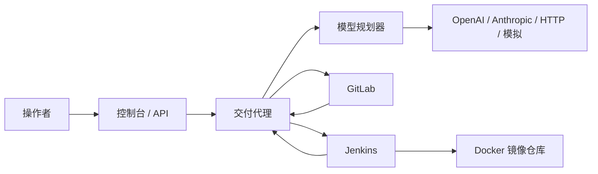

# 交付代理 Delivery Agent

交付代理把一次产品发布收成一条可追踪的记录。操作者提交仓库、版本、产品名、目标环境和一段说明，代理会解析 GitLab 项目、生成交付计划、触发 GitLab 流水线、运行 Jenkins 任务、确认 Docker 镜像，并给出发布结果。

模型只负责说明计划和有限的开关。真正执行的阶段是固定的，所以没有配置模型时，同一条流水线仍然能跑完。本地默认使用模拟的 GitLab、Jenkins 和模型，不需要真实令牌。

## 能力

- 接收交付请求：仓库路径、分支或标签、产品名、目标环境、可选的自然语言说明。
- 模型无关：OpenAI 兼容接口、Anthropic Messages API、通用 HTTP 适配器，以及离线模拟模型。用 `LLM_PROVIDER=none` 可以完全不调用模型。
- GitLab：按路径查询项目、解析提交、触发流水线、接收 Webhook。`GITLAB_MODE=mock` 可离线演示。
- Jenkins：带参数触发任务、轮询构建、读取控制台日志、接收状态回调。`JENKINS_MODE=mock` 可离线演示。
- Docker：示例 Dockerfile、Jenkins 构建并推送镜像的模板，以及代理侧的构建推送实现。默认由 Jenkins 发布，代理核对日志里的镜像坐标。
- 网页控制台和 HTTP API。控制台文案为简体中文。

## 架构



一次交付固定经过这些阶段：

| 阶段 | 做什么 |
| --- | --- |
| 解析代码仓库 | 按路径查找 GitLab 项目，并把分支或标签解析成提交 SHA |
| 生成交付计划 | 调用所选模型生成中文说明；失败或未配置模型时使用确定性计划 |
| 触发 GitLab 流水线 | 创建流水线并传入交付编号。可用配置或说明跳过 |
| 执行 Jenkins 构建 | 传入仓库地址、版本、镜像坐标和回调地址，等待构建结束 |
| 确认镜像发布 | 默认核对 Jenkins 日志中的 `pushed image`；也可改为由代理本地构建推送 |
| 汇总交付结果 | 记录镜像、提交、Jenkins 构建号和 GitLab 流水线 |

安全边界：模型不能新增 shell 步骤，也不能改写 Jenkins 参数的结构。它只能填写说明、风险，以及是否触发 GitLab 流水线。操作者在说明里写「跳过 GitLab」或 `skip gitlab` 时，平台会强制跳过该阶段。

## 目录

```text
src/delivery_agent/          服务、编排、模型和客户端
src/delivery_agent/providers 模型供应商实现
src/delivery_agent/integrations  GitLab、Jenkins、Docker 客户端
examples/sample-product      可被流水线构建的示例产品
examples/pipelines           与示例产品相同的 Jenkinsfile 模板
examples/demo-request.json   模拟模式的示例请求
scripts/demo.sh              提交一次交付并等待结果
docker-compose.yml           本地一键启动
```

## 本地运行

需要 Docker Compose v2，或者本机 Python 3.11 以上。

### 用 Compose 启动模拟模式

在仓库根目录执行：

```bash
docker compose up --build
```

代理监听 [http://localhost:8080](http://localhost:8080)。打开这个地址就是控制台。接口文档在 [http://localhost:8080/docs](http://localhost:8080/docs)。

这一模式不会连接真实的 GitLab 或 Jenkins。健康检查可以确认进程已经就绪：

```bash
curl -sS http://127.0.0.1:8080/api/v1/health
```

### 端到端演示

另开一个终端，在仓库根目录执行：

```bash
chmod +x scripts/demo.sh
./scripts/demo.sh
```

脚本会提交 `examples/demo-request.json`，并等待整条流水线结束。成功时返回的 JSON 里应包含：

- `"status": "succeeded"`
- `"plan"."source": "mock"`
- `"artifact"."image"`，形如 `localhost:5000/delivery/sample-product:<12位sha>-staging`
- `"artifact"."image_confirmed": true`

也可以在控制台里直接使用已经填好的表单，点「提交交付」。页面会轮询状态。

两条失败示例，同样在模拟模式可用：

- 仓库写成 `missing/sample-product`：解析阶段失败，提示找不到项目。
- 产品名写成 `broken-product`：Jenkins 构建失败，后续阶段跳过。

### 不用 Docker，直接跑服务

```bash
python -m pip install -e ".[dev]"
cp .env.example .env
delivery-agent
```

开发时也可以：

```bash
pytest
ruff check src tests
```

## 配置

所有配置都来自环境变量。复制 `.env.example` 为 `.env` 后按需修改。Compose 会自动读取项目目录里的 `.env` 做变量替换；没有这个文件时使用模拟模式默认值。

不要把真实令牌写进仓库。`.env` 已被忽略。

### 模型供应商

| 变量 | 作用 |
| --- | --- |
| `LLM_PROVIDER` | `mock`、`openai`、`anthropic`、`http` 或 `none` |
| `OPENAI_BASE_URL` / `OPENAI_API_KEY` / `OPENAI_MODEL` | OpenAI 兼容 Chat Completions。兼容 vLLM、Ollama 的 `/v1`、DeepSeek 等 |
| `OPENAI_JSON_MODE` | 是否发送 `response_format=json_object`。部分兼容服务需要关掉 |
| `ANTHROPIC_API_KEY` / `ANTHROPIC_BASE_URL` / `ANTHROPIC_MODEL` | Anthropic Messages API |
| `HTTP_LLM_URL` / `HTTP_LLM_API_KEY` / `HTTP_LLM_MODEL` | 通用 HTTP 适配器。`HTTP_LLM_URL` 是完整端点 |
| `HTTP_LLM_STYLE` | `openai` 发送 Chat Completions 请求体；`prompt` 发送 `{"model","prompt"}` |

`LLM_PROVIDER=none` 不访问任何模型。模型调用失败时，当前交付会退回确定性计划并继续执行，不会因此中断。

本地兼容服务可以不填 `OPENAI_API_KEY`。Anthropic 和通用 HTTP 在缺少密钥或地址时会在规划阶段退回确定性计划。

### GitLab

| 变量 | 作用 |
| --- | --- |
| `GITLAB_MODE` | `mock` 或 `live` |
| `GITLAB_BASE_URL` | 实例根地址，例如 `https://gitlab.example.com`。支持子路径 |
| `GITLAB_TOKEN` | 个人访问令牌或项目令牌，需要 `api` 范围才能创建流水线 |
| `GITLAB_WEBHOOK_TOKEN` | 校验请求头 `X-Gitlab-Token`。未配置时拒绝所有回调 |
| `GITLAB_TRIGGER_PIPELINE` | 设为 `false` 时不调用创建流水线接口 |

把现有 GitLab 接进来时，保持 Compose 运行，在 `.env` 中设置：

```bash
GITLAB_MODE=live
GITLAB_BASE_URL=https://gitlab.example.com
GITLAB_TOKEN=替换成你的令牌
GITLAB_WEBHOOK_TOKEN=一段随机字符串
```

然后重新启动：

```bash
docker compose up --build
```

在 GitLab 项目的 Webhook 设置里，把 URL 指到 `http://<代理地址>/api/v1/webhooks/gitlab`，Secret token 填同一个 `GITLAB_WEBHOOK_TOKEN`。流水线回调会写进对应的交付记录。GitLab 流水线的最终成败不会单独决定这次交付，镜像以 Jenkins 结果为准。示例产品里的 `.gitlab-ci.yml` 只做语法检查。

模拟模式的约定：路径中任意一段叫 `missing` 时返回找不到项目。

### Jenkins

| 变量 | 作用 |
| --- | --- |
| `JENKINS_MODE` | `mock` 或 `live` |
| `JENKINS_BASE_URL` | Jenkins 根地址。Compose 网络内默认是 `http://jenkins:8080` |
| `JENKINS_USER` / `JENKINS_TOKEN` | API 用户和 API Token |
| `JENKINS_JOB` | 任务名，支持文件夹，例如 `team/delivery-pipeline` |
| `JENKINS_WEBHOOK_TOKEN` | 校验请求头 `X-Jenkins-Token` |
| `JENKINS_POLL_INTERVAL_SECONDS` | 轮询间隔 |
| `PIPELINE_TIMEOUT_SECONDS` | 等待 Jenkins 的最长时间 |

在 Jenkins 中新建 Pipeline 任务，Script Path 使用：

```text
examples/pipelines/docker-delivery.Jenkinsfile
```

示例产品目录里有一份相同的文件，方便把 `examples/sample-product` 单独推到 GitLab。任务需要一个能运行 Docker 的节点。模板会：

1. 按 `GIT_URL` 和 `GIT_SHA`（没有 SHA 时用 `GIT_REF`）检出代码。
2. 如果存在 `app.py`，用 `python3 -m py_compile` 做检查。
3. `docker build` 然后 `docker push`，并打印 `pushed image <仓库>:<标签>`。
4. 向 `AGENT_CALLBACK_URL` 回调。令牌读取 Jenkins 控制器上的环境变量 `JENKINS_WEBHOOK_TOKEN`，不要写进 Jenkinsfile。

代理传给 Jenkins 的参数：

| 参数 | 含义 |
| --- | --- |
| `PRODUCT_NAME` | 产品名 |
| `GIT_URL` | GitLab HTTP 克隆地址 |
| `GIT_REF` | 分支或标签 |
| `GIT_SHA` | 解析后的提交 |
| `IMAGE_REPO` | 不含标签的镜像仓库 |
| `IMAGE_TAG` | `<提交前 12 位>-<环境>` |
| `TARGET_ENV` | 目标环境 |
| `DELIVERY_ID` | 交付编号 |
| `AGENT_CALLBACK_URL` | `<PUBLIC_BASE_URL>/api/v1/webhooks/jenkins` |

可选地在本机拉起一个 Jenkins：

```bash
docker compose --profile jenkins up --build
```

控制器在宿主机的 [http://localhost:8081](http://localhost:8081)。首次解锁密码：

```bash
docker compose exec jenkins cat /var/jenkins_home/secrets/initialAdminPassword
```

这个 Jenkins 镜像没有预装 Docker 插件，也不会自动创建任务。它用来对接你自己的配置。完成一次真实发布时，把 `JENKINS_MODE=live`，并让任务跑在有 Docker 的节点上。模拟模式不依赖这个容器。

### Docker 镜像仓库

| 变量 | 作用 |
| --- | --- |
| `DOCKER_REGISTRY` | 例如 `localhost:5000` |
| `DOCKER_NAMESPACE` | 例如 `delivery` |
| `SHIP_STRATEGY` | `jenkins`（默认）或 `agent` |
| `DOCKER_MODE` | `mock` 或 `local`。`local` 只在 `SHIP_STRATEGY=agent` 时由代理调用 `docker` CLI |
| `DOCKER_CONTEXT` / `DOCKER_DOCKERFILE` | 代理自己构建时使用的上下文。第一版不会按请求去克隆任意仓库 |

镜像坐标是：

```text
<DOCKER_REGISTRY>/<DOCKER_NAMESPACE>/<产品名小写>:<提交前12位>-<环境>
```

本地起一个仓库：

```bash
docker compose --profile registry up --build
```

仓库地址是 `localhost:5000`。把 Docker 配置为允许这个不安全仓库后，Jenkins 节点才能推送。

如果希望代理自己构建示例产品，而不是等 Jenkins 推送：

```bash
SHIP_STRATEGY=agent
DOCKER_MODE=local
```

并给代理挂载 Docker socket。这等于把宿主机 Docker 的权限交给代理，只在可信环境使用：

```yaml
services:
  agent:
    volumes:
      - /var/run/docker.sock:/var/run/docker.sock
```

`DOCKER_MODE=mock` 时不会调用 Docker，只会记录将要推送的坐标。

## 如何新增一个模型供应商

1. 在 `src/delivery_agent/providers/` 新建模块，继承 `LLMProvider`。
2. 实现 `name` 和 `async complete(messages, *, json_mode=False) -> LLMResponse`。
3. 在 `providers/registry.py` 的 `create_provider()` 里按 `LLM_PROVIDER` 的新名字返回它。
4. 在 `config.py` 的 `validate_settings()` 里允许这个名字，并用环境变量接收地址、模型和密钥。
5. 用 `httpx.MockTransport` 写一个请求形状测试，放进 `tests/test_providers.py`。

规划器要求模型只返回 JSON：`summary`、`rationale`、`steps`、`trigger_gitlab_pipeline`、`risks`。`steps[].key` 必须是上面表格里的阶段名，其他 key 会被丢掉。解析失败就使用确定性计划。

最小实现：

```python
from delivery_agent.providers.base import ChatMessage, LLMProvider, LLMResponse

class MyProvider(LLMProvider):
    name = "my-provider"

    async def complete(self, messages: list[ChatMessage], *, json_mode: bool = False) -> LLMResponse:
        text = await call_your_backend(messages)
        return LLMResponse(text=text, model="my-model", provider=self.name)
```

## API

| 方法 | 路径 | 作用 |
| --- | --- | --- |
| `GET` | `/api/v1/health` | 运行模式，不返回令牌 |
| `POST` | `/api/v1/deliveries` | 创建交付并在后台执行 |
| `POST` | `/api/v1/deliveries?wait=true` | 创建并等到结束或超时 |
| `GET` | `/api/v1/deliveries` | 最近的交付 |
| `GET` | `/api/v1/deliveries/{id}` | 单条交付，含阶段、计划和日志 |
| `POST` | `/api/v1/webhooks/gitlab` | GitLab 回调，头 `X-Gitlab-Token` |
| `POST` | `/api/v1/webhooks/jenkins` | Jenkins 回调，头 `X-Jenkins-Token` |
| `GET` | `/api/v1/webhooks` | 最近收到的回调摘要 |

创建请求：

```json
{
  "repo": "demo/sample-product",
  "ref": "main",
  "product_name": "sample-product",
  "target_environment": "staging",
  "instruction": "把示例产品发布到预发环境"
}
```

`target_environment` 使用小写字母、数字和连字符，以便直接放进镜像标签。

## 示例产品

`examples/sample-product` 是一个标准库 HTTP 服务，监听 8000，返回产品名和状态。Dockerfile 以非 root 用户运行。可以单独构建：

```bash
docker build -t sample-product:dev examples/sample-product
docker run --rm -p 8000:8000 sample-product:dev
```

## 开发与测试

```bash
python -m pip install -e ".[dev]"
pytest
ruff check src tests
```

测试覆盖：

- 四个模型入口的请求形状，以及注册表如何按配置选择
- 规划失败后退回确定性计划，交付仍然成功
- GitLab、Jenkins 的模拟模式和真实客户端的 URL、令牌、参数
- 编排：成功、跳过 GitLab、找不到仓库、Jenkins 失败、代理侧推送镜像
- API、控制台页面和 Webhook 鉴权

GitHub Actions 会跑上述检查，并构建代理镜像。产品发布路径仍然是 GitLab + Jenkins + Docker，不使用 GitHub Actions 做产品交付。

## 安全说明

- 令牌只通过环境变量进入进程。示例里的 `dev-gitlab-token` 和 `dev-jenkins-token` 只用于本机。
- Webhook 使用共享令牌，并用常量时间比较。令牌为空时回调一律拒绝。
- Jenkins 回调令牌放在 Jenkins 的环境或凭据里，模板不会把它写进构建参数。
- 构建日志可能含有仓库地址和命令输出，交付记录保存在本地 SQLite（`data/delivery-agent.db`）。
- 挂载 `docker.sock` 之前先确认运行环境可信。

## 许可证

MIT，见 [LICENSE](LICENSE)。
